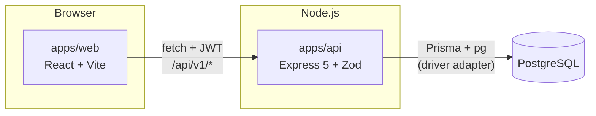

# Kitanda

> Gestão de stock e vendas para pequenas lojas e cantinas: API REST segura + painel em React.


**Credenciais de demonstração:** `admin@kitanda.ao` / `admin123`

## O problema

Pequenas lojas e cantinas em Angola costumam controlar stock e vendas em cadernos ou de cabeça.
Isso faz perder vendas quando um produto acaba sem aviso, e ninguém sabe ao certo o que vende
mais. O Kitanda resolve isto com um sistema simples: registar produtos, entradas de stock e
vendas, e ver um painel com o que importa.

## Funcionalidades

- Produtos, categorias e entradas/ajustes de stock, com alerta de stock baixo
- Registo de vendas (dinheiro, Multicaixa, transferência) em transacção — o stock e a venda
  nunca ficam dessincronizados, mesmo se um item falhar a meio
- Painel com vendas do dia/mês, gráfico de vendas dos últimos 30 dias e top 5 produtos
- Dois papéis — `ADMIN` (gere tudo) e `CASHIER` (regista vendas) — com permissões aplicadas
  tanto na API como no frontend
- Documentação interactiva da API em `/api/docs` (Swagger UI gerado a partir dos schemas Zod)

## Stack

| Camada | Tecnologias |
|--------|-------------|
| Backend | Node.js, TypeScript, Express 5, PostgreSQL, Prisma 7 (driver adapters), Zod, JWT, bcrypt |
| Frontend | React, TypeScript, Vite, React Router, TanStack Query, Recharts, Tailwind CSS |
| Qualidade | Vitest, Supertest, Testing Library, ESLint, GitHub Actions |
| Infra | Docker, Docker Compose, Render/Railway, Vercel |

## Arquitectura



A API nunca confia só no payload do JWT: cada pedido autenticado confirma na base de dados que
o utilizador ainda existe (um utilizador apagado perde o acesso de imediato, não só quando o
token expirar). O stock só muda por duas vias — `POST /products/:id/stock` (entradas/ajustes) e
`POST /sales` (vendas) — nunca por um `PATCH` directo, para o histórico de `StockMovement` ser
sempre a fonte de verdade de porque é que o stock mudou.

## Como correr localmente

### Com Docker (mais simples)

```bash
cp .env.example .env
docker compose up --build
```

Isto sobe a base de dados, corre as migrações automaticamente e arranca a API e a web.

- API: http://localhost:3333/api/v1/health · Docs: http://localhost:3333/api/docs
- Web: http://localhost:5173

### Em modo de desenvolvimento (com hot reload)

```bash
cp .env.example .env && cp .env.example apps/api/.env
npm install
docker compose up -d db
npm run dev
```

Para teres dados de exemplo (categorias, produtos, vendas e o utilizador de demonstração):

```bash
npm run db:migrate -w apps/api
npm run db:seed -w apps/api
```

## Testes

```bash
npm test            # todos os workspaces
npm run typecheck
npm run lint
```

A API é testada com Vitest + Supertest contra uma base de dados Postgres real (não mocks) —
inclui um teste que prova que uma venda com um item sem stock **não grava nada**, nem a venda
nem o stock dos outros itens. O frontend é testado com Vitest + Testing Library, focado no que
o utilizador vê e faz.

## Segurança

- Palavras-passe com bcrypt (custo 10), nunca devolvidas pela API
- JWT com expiração; `authenticate` confirma o utilizador na base de dados em cada pedido
- Helmet, CORS restrito à origem do frontend, rate limit no login (5 tentativas/minuto)
- Validação de todo o input com Zod (`body`, `params`, `query`)
- Autorização por papel num middleware (`requireRole`)
- Erros internos nunca expõem stack trace ao cliente
- Queries só pelo Prisma, ou SQL parametrizado (`$queryRaw` com template tags, nunca
  concatenação de strings)

## Estrutura

```
apps/api   backend (REST)
apps/web   frontend (React)
docs/      especificação, roteiro e guia de deploy
```

---
Feito por **Cesénio Filipe**: [LinkedIn](https://linkedin.com/in/cesénio-filipe-003b78319)
